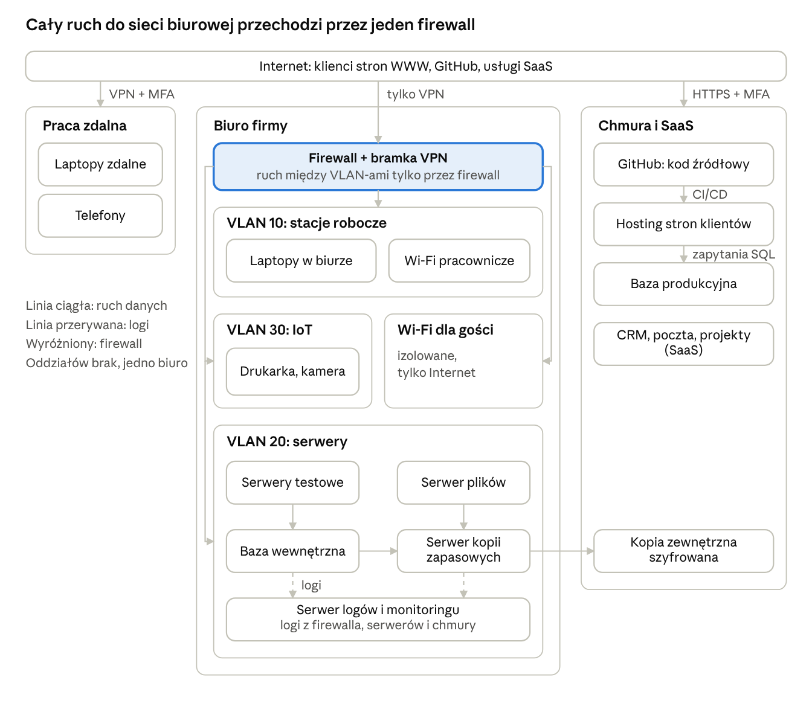

# Architektura środowiska

Źródło diagramu do edycji: [diagrams/architecture.drawio](../diagrams/architecture.drawio). Otwiera się w app.diagrams.net. Plik ma dwie strony: architekturę i przepływy danych.

## Główne decyzje projektowe

**Cały ruch z Internetu do biura przechodzi przez jeden firewall z bramką VPN.** Z zewnątrz dostępna jest tylko bramka VPN. Dzięki temu serwery w biurze nie są widoczne w Internecie, a każde połączenie zdalne wymaga VPN i MFA.

**Sieć biurowa jest podzielona na trzy VLAN-y i osobne Wi-Fi dla gości.**

| Strefa | Co w niej jest | Dlaczego osobno |
|---|---|---|
| VLAN 10, stacje robocze | Laptopy w biurze, Wi-Fi pracownicze (WPA3 Enterprise) | Laptop najłatwiej zainfekować phishingiem, więc nie może mieć swobodnego dostępu do serwerów |
| VLAN 20, serwery | Serwer plików, serwery testowe, baza wewnętrzna, serwer kopii, serwer logów | Najcenniejsze dane, dostęp tylko na potrzebne porty |
| VLAN 30, IoT | Drukarka, kamera | Urządzenia rzadko aktualizowane, z domyślnymi hasłami, więc odcięte od reszty |
| Wi-Fi dla gości | Urządzenia gości | Tylko Internet, zero dostępu do sieci firmy |

Ruch między strefami idzie wyłącznie przez firewall z zasadą "domyślnie blokuj". Dlaczego: gdy atakujący przejmie jeden laptop albo drukarkę, nie dostaje się automatycznie do serwerów (ryzyka R9, R12).

**Produkcja jest w chmurze, a nie w biurze.** Strony klientów i ich bazy działają w hostingu chmurowym, kod w GitHub, a CRM i poczta to SaaS. Biuro nie jest więc pojedynczym punktem awarii dla klientów, ale rośnie znaczenie konfiguracji chmury i kont administratorów (R5, R7).

**Kopie zapasowe są w dwóch miejscach.** Serwer kopii w biurze i szyfrowana, niezmienialna kopia w chmurze. Jedna kopia jest poza zasięgiem ransomware, który zaszyfrowałby sieć biurową (R11).

## Przepływy danych

| Przepływ | Gdzie dane leżą | Którędy idą | Kto ma dostęp | Gdzie może dojść do naruszenia |
|---|---|---|---|---|
| Klient → strona WWW → baza produkcyjna → kopia | Baza w chmurze hostingowej, kopia w chmurze zewnętrznej | Internet (HTTPS), sieć dostawcy hostingu | Aplikacja (konto serwisowe), administrator baz, DevOps | SQL Injection, przestarzała baza, wyciek hasła do bazy, publiczny zasób w chmurze |
| Pracownik zdalny → VPN → serwer plików i serwery testowe | Serwery w biurze, kopie lokalne na laptopie | Tunel VPN, w biurze VLAN 20 | Pracownicy według grup projektowych, administrator IT | Przejęte hasło do VPN, skradziony laptop, zbyt szerokie uprawnienia, niezaszyfrowane dane lokalne |
| Programista → GitHub → CI/CD → hosting | Repozytoria GitHub, kopia robocza na laptopie | HTTPS lub SSH, automatyczne wdrożenie | Programiści, Tech Lead, konto serwisowe CI/CD | Wyciek kodu, klucze w repozytorium, przejęte konto GitHub, złośliwa zmiana bez przeglądu |
| Serwery → serwer kopii → kopia w chmurze | Serwer kopii w biurze i chmura | LAN (VLAN 20), potem szyfrowany kanał | Konto serwisowe backupu, administrator IT | Ransomware szyfruje także kopie, brak testu odtwarzania |

## Zabezpieczenia i uzasadnienie

Każde zabezpieczenie odpowiada na konkretne ryzyko z [risks.md](risks.md).

| Zabezpieczenie | Gdzie i jak | Dlaczego | Ryzyka |
|---|---|---|---|
| MFA | Administratorzy, VPN, GitHub, chmura, poczta, CRM. Klucz sprzętowy dla administratorów | Najtańszy sposób, żeby wyciek hasła (phishing, powtórzone hasła) nie oznaczał przejęcia konta | R3, R5, R7, R8 |
| Segmentacja i firewall | Trzy VLAN-y, Wi-Fi gości, "domyślnie blokuj", z Internetu tylko VPN | Zatrzymuje ruch boczny z zainfekowanego laptopa lub drukarki do serwerów | R4, R8, R9, R12 |
| VPN | Dostęp do serwerów tylko przez VPN i według grup | Chroni przed podsłuchem w obcych sieciach i ogranicza, co widzi pracownik zdalny | R8, R9 |
| Szyfrowanie | Dyski laptopów (BitLocker), TLS, baza i kopia zewnętrzna | Skradziony laptop lub kopia bez klucza są bezużyteczne | R1, R3, R13 |
| Kopie zapasowe | 3-2-1, jedna kopia offline lub niezmienialna, test odtwarzania co kwartał | Kopia, której nie da się zaszyfrować ani odtworzyć, nie chroni przed ransomware | R4, R11 |
| Kontrola dostępu i najmniejsze uprawnienia | Uprawnienia według grup projektowych, konto aplikacji bez praw administratora bazy | Ogranicza skutki SQL Injection i kradzieży kodu do jednego wycinka | R1, R2 |
| Konta administratorów | Osobne konta administracyjne, bez kont współdzielonych, hasła w menedżerze | Jedno przejęte konto codzienne nie daje pełnej kontroli | R7 |
| Monitoring i logowanie | Centralne logi z firewalla, serwerów i chmury, alerty | Atak wykryty po godzinach, a nie po tygodniach; logi są też dowodem po incydencie | R14 |
| Aktualizacje i stacje robocze | Miesięczne aktualizacje, EDR, brak praw administratora, szkolenia | Większość ataków wykorzystuje znane, załatane już podatności | R1, R3, R4 |
| Kontrola kodu i sekretów | Ochrona gałęzi głównej, przegląd zmian, skanowanie sekretów | Hasło w repozytorium jest dostępne dla każdego, kto zobaczy kod | R2, R10 |
| Konfiguracja chmury i telefonów | Lista kontrolna, brak domyślnych haseł, blokada ekranu, zdalne wylogowanie | Błąd konfiguracji jest najczęstszą przyczyną wycieków z chmury | R5, R15 |
| Dokumentacja i zastępstwa | Dwie osoby znają każdy krytyczny system | Firma nie staje, gdy jedna osoba odejdzie lub zachoruje | R16 |
